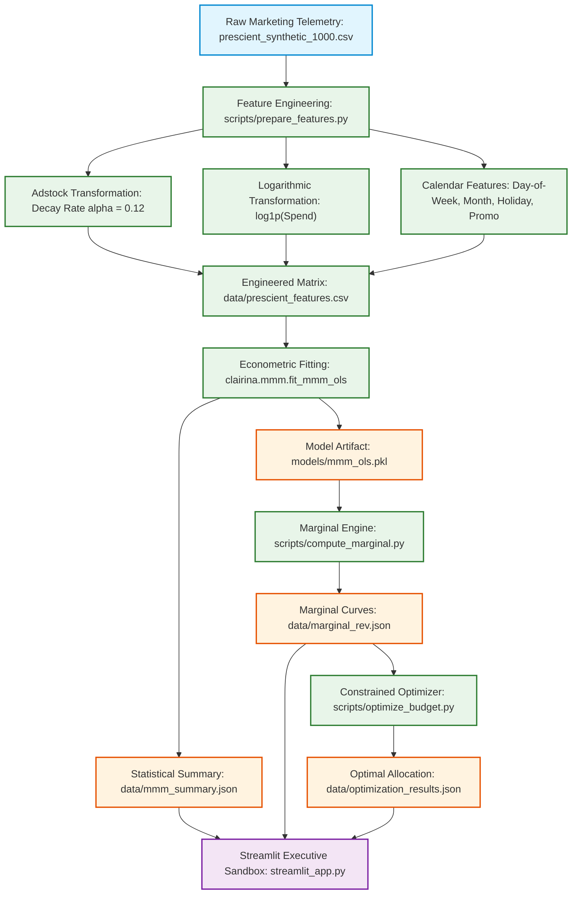
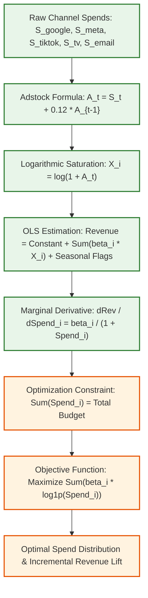

# Product Requirements Document (PRD): PrescientLens-Clairina (Econometric Marketing-Mix Modeling & Capital Optimization Engine)

**Product Lead:** Uday Kiran  
**Status:** MVP Operational / Production Python Package & Interactive Streamlit Engine  
**GitHub Repository:** `https://github.com/Uday-Kiran-01/Clairina`  
**Product Category:** B2B SaaS Enterprise Marketing Intelligence / Econometric Capital Allocation Platform  
**System Architecture:** Python 3.10+ Package (`clairina`) + Ordinary Least Squares (OLS) Regression + Constrained SciPy Non-Linear Optimizer + Defensive Streamlit Interactive Simulation Sandbox  

---

## 1. Executive Summary

### 1.1 Context & Background: The Proactive Candidate Initiative
PrescientLens-Clairina was conceptualized and engineered with a distinct, proactive objective: I identified Prescient AI and the modern Marketing-Mix Modeling (MMM) domain as a compelling intersection of econometrics, capital efficiency, and executive product management. Rather than submitting a standard resume through traditional job boards, I chose to demonstrate direct domain mastery by designing and building a working, production-grade econometric MMM pipeline and interactive budget optimization sandbox before initiating outreach.

### 1.2 The Industry Friction: The Attribution Collapse
Growth leaders and Chief Marketing Officers (CMOs) oversee millions of dollars in annual media expenditure across Google Ads, Meta, TikTok, TV, and email. However, measuring the true incremental return on investment (MROI) has become fundamentally broken:
*   **The Last-Click Attribution Fallacy:** Digital marketing dashboards credit 100% of purchase conversions to whichever ad received the final user click. This heavily over-credits bottom-of-funnel branded search campaigns while starving top-of-funnel awareness channels (YouTube, TV, TikTok) of necessary capital.
*   **The Death of Third-Party Cookies:** Privacy regulations (GDPR) and platform security changes (Apple App Tracking Transparency) have destroyed deterministic user-level ad tracking. Multi-touch attribution (MTA) models relying on cross-site tracking pixels have lost accuracy.
*   **The Enterprise Consulting Black Box:** Traditional econometric agency models require 3 to 6 months of consulting engagements and cost hundreds of thousands of dollars, delivering static slide decks that are obsolete by the time executive teams review them.

### 1.3 The Product Solution: PrescientLens-Clairina
PrescientLens-Clairina provides an explainable, privacy-safe econometric modeling platform that quantifies true advertising elasticity, detects diminishing marginal returns, and mathematically solves the optimal capital reallocation:
1.  **Privacy-First Econometrics:** Operates exclusively on aggregate, time-series spend and revenue data, requiring zero user-level tracking or invasive cookies.
2.  **Adstock & Logarithmic Saturation Transformations:** Models real-world advertising decay (lagged carryover effects) and diminishing marginal returns (Hill saturation and logarithmic transforms).
3.  **Ordinary Least Squares (OLS) with Confidence Intervals:** Delivers transparent, auditable elasticity coefficients ($\beta$) that a Chief Financial Officer (CFO) can inspect and defend to a board.
4.  **Constrained Mathematical Budget Optimizer:** Leverages SciPy non-linear optimization (`scipy.optimize.minimize`) alongside discrete grid search to recommend the exact dollar reallocation that maximizes revenue under fixed budget constraints.
5.  **Defensive Interactive Simulation Sandbox:** A resilient Streamlit application (`streamlit_app.py`) featuring self-healing diagnostic panels, step-by-step pipeline execution, and what-if scenario sliders with zero blank-page crashes.

---

## 2. Product Vision & North Star

### 2.1 Product Vision
To democratize enterprise econometric marketing intelligence, transforming media budget planning from an emotional, last-click guessing game into an auditable, mathematical capital allocation discipline.

### 2.2 North Star Metric
*Incremental Revenue Lift Ratio (IRLR):* The percentage increase in projected marketing-driven revenue achieved solely by reallocating existing channel budgets without increasing total advertising spend.

### 2.3 Supporting Key Performance Indicators (KPIs)
1.  **Econometric Fit Quality ($R^2$ & Significance):** Model explanation power exceeding 85% ($R^2 > 0.85$) with statistically significant channel coefficients ($p < 0.05$).
2.  **Marginal Revenue Threshold Precision:** Sub-dollar calculation accuracy determining the exact spend saturation threshold where marginal revenue per dollar spent falls below $1.00.
3.  **Simulation Response Latency:** Execution time under 2 seconds for continuous non-linear budget optimization across multi-channel spend constraints.
4.  **Diagnostic System Reliability:** 100% uptime on the Streamlit simulation sandbox, preventing blank-screen crashes through defensive data validation guards.

---

## 3. Problem Statement

### 3.1 The Wanamaker Paradox in the Digital Era
Over a century ago, merchant John Wanamaker famously stated: *"Half the money I spend on advertising is wasted; the trouble is I don't know which half."* Modern digital marketing exacerbates this problem. Because platforms operate in competitive silos, Google and Meta both claim full credit for the same conversion, leading to duplicate attribution and misallocated capital.

### 3.2 The Diminishing Marginal Returns Blindspot
Marketing channels follow the economic law of diminishing marginal returns. While the first $10,000 spent on Google Ads may yield $4.00 per dollar, increasing spend to $100,000 pushes the channel into saturation, where each additional dollar yields only $0.40. Without marginal revenue curves, growth teams over-saturate mature channels and underfund emerging channels.

### 3.3 The Black-Box AI Credibility Gap
Deep learning models and complex neural networks can predict aggregate sales, but they lack interpretable parameters. A CFO will not authorize an $80,000 budget reallocation based on an unexplainable weight matrix. Executive leadership demands auditable, linear-econometric transparency.

---

## 4. Goals & Non-Goals

### 4.1 Goals
*   **G-01 (Feature Engineering Pipeline):** Transform raw daily marketing spend telemetry into econometric variables incorporating adstock decay rates (half-life memory), logarithmic saturation, calendar seasonalities, and holiday indicators.
*   **G-02 (Auditable Econometric Fitting):** Fit Ordinary Least Squares (OLS) regression models using `statsmodels`, capturing parameter coefficients, confidence intervals (lower/upper bounds), and variance statistics.
*   **G-03 (Marginal Revenue Calculus):** Derive first-order marginal revenue equations ($\frac{\partial \text{Rev}}{\partial \text{Spend}_i} = \frac{\beta_i}{1 + \text{Spend}_i}$) to identify the exact channel saturation threshold.
*   **G-04 (Constrained Budget Optimizer):** Deliver both coarse grid-search and continuous SciPy non-linear optimization routines that solve for maximum total revenue subject to equality budget constraints ($\sum \text{Spend}_i = \text{Budget}_{\text{total}}$).
*   **G-05 (Defensive Interactive Dashboard):** Provide an interactive Streamlit application that verifies data dependencies on load, supports on-demand pipeline execution, and provides what-if budget simulation sliders.

### 4.2 Non-Goals
*   **NG-01 (Real-Time Bid Auctioning):** Clairina is an executive strategic planning platform; it does not connect to real-time programmatic ad exchanges for sub-second keyword bidding.
*   **NG-02 (User-Level Identity Tracking):** The platform strictly avoids collecting cookies, IP addresses, device fingerprints, or PII.
*   **NG-03 (Black-Box Deep Neural Networks):** Core modeling intentionally avoids uninterpretable deep neural architectures to preserve statistical transparency.

---

## 5. Users & Personas (The Human Element)

### 5.1 Persona 1: The Chief Marketing Officer (CMO)
*   **Profile:** Executive overseeing multi-million dollar annual budgets across brand and performance channels.
*   **Emotional State & Pain Point:** Fatigued by platform dashboards that all claim 100% credit. Anxious about board meetings where they must justify why increased ad spend did not produce proportional revenue growth.
*   **The Need:** An objective, channel-agnostic measurement system that proves where the next marketing dollar should go.
*   **System Response:** Visual marginal revenue curves demonstrating channel saturation points and recommended budget reallocations that increase total revenue without increasing total spend.

### 5.2 Persona 2: The Chief Financial Officer (CFO)
*   **Profile:** Executive responsible for corporate capital efficiency, margin protection, and return on invested capital.
*   **Emotional State & Pain Point:** Skeptical of marketing jargon (impressions, click-through rates, platform ROAS); demands clear economic causality and auditable metrics.
*   **The Need:** A transparent mathematical model with standard confidence intervals, variance inflation factors, and auditable parameter equations.
*   **System Response:** Structured econometric model summaries (`mmm_summary.json`) containing OLS coefficients, standard errors, and confidence intervals.

### 5.3 Persona 3: The Growth Marketing Lead / Media Buyer
*   **Profile:** Hands-on operational leader executing weekly budget allocations across Google, Meta, TikTok, and TV.
*   **Emotional State & Pain Point:** Needs to make tactical budget decisions on Monday mornings without waiting three months for an external consulting agency report.
*   **The Need:** An interactive "what-if" simulator where they can adjust channel spend sliders and see projected marginal impacts in real time.
*   **System Response:** An interactive Streamlit simulation sandbox (`streamlit_app.py`) allowing instant what-if scenario testing.

---

## 6. End-to-End System Architecture



---

## 7. Product Scope & Boundary Management

### 7.1 Scope Matrix (Executed vs Planned vs Out of Scope)

| Capability / Feature | MVP (Executed in Repository) | Future Expansion (Planned) | Out of Scope |
| :--- | :---: | :---: | :---: |
| **Synthetic Multi-Channel Telemetry (1,000 Days)** | Yes (`generate_dataset.py`) | Automated Snowflake/BigQuery connectors | No |
| **Adstock Decay Carryover** | Yes (`clairina/mmm.py`) | Channel-specific variable decay rates | No |
| **Logarithmic Saturation Modeling** | Yes (`log1p` transforms) | Weibull / Generalized Hill curves | No |
| **Ordinary Least Squares (OLS) Fitting** | Yes (`statsmodels.api.OLS`) | Fully Bayesian MCMC default pipeline | No |
| **Marginal Revenue per Dollar Calculus** | Yes (`compute_marginal.py`) | Dynamic price elasticity integration | No |
| **Continuous SciPy Budget Optimizer** | Yes (`scipy.optimize.minimize`) | Multi-period dynamic portfolio rebalancing | No |
| **Coarse Grid Search Optimizer** | Yes (`optimize_budget.py`) | Genetic algorithm global search | No |
| **Defensive Sidebar Status Diagnostics** | Yes (`streamlit_app.py`) | Automated Slack alerting bot | No |
| **Local LLM Executive Explanations** | Yes (Optional Ollama / Mistral) | Fine-tuned proprietary marketing LLM | No |
| **User-Level Tracking Cookies** | No | No | Strictly Out of Scope |
| **Real-Time Programmatic Ad Exchange Bidding** | No | No | Strictly Out of Scope |

---

## 8. Functional Requirements (16 Formal Specifications)

### 8.1 Module 1: Data Ingestion & Econometric Transformations (DIET)

#### FR-DIET-01: Synthetic Multi-Channel Data Generator
*   **Priority:** P0 (Critical)
*   **Description:** The system must generate a reproducible 1,000-day synthetic dataset (`data/prescient_synthetic_1000.csv`) modeling 6 marketing channels (Google, Meta, TikTok, Email, TV, Organic), calendar season, promotions, holidays, and realistic revenue.
*   **Acceptance Criteria:**
    *   *Given* execution of `scripts/generate_dataset.py`,
    *   *When* executed with seed 123,
    *   *Then* it outputs exactly 1,000 time-ordered daily rows containing spend and revenue columns without null values.

#### FR-DIET-02: Adstock Memory Decay Transformation
*   **Priority:** P0 (Critical)
*   **Description:** The system must compute lagged advertising carryover using an exponential decay formula ($x_t = \text{raw}_t + \alpha \cdot x_{t-1}$) to capture lingering consumer purchase intent.
*   **Acceptance Criteria:**
    *   *Given* daily spend series for a channel,
    *   *When* `adstock(series, rate=0.12)` is applied,
    *   *Then* yesterday's spend carries forward with decay rate $\alpha$, creating a smooth cumulative exposure metric.

#### FR-DIET-03: Logarithmic Saturation Feature Scaling
*   **Priority:** P0 (Critical)
*   **Description:** The system must transform adstocked spend into logarithmic space using $\log(1 + x)$ to model diminishing marginal returns.
*   **Acceptance Criteria:**
    *   *Given* adstocked channel values,
    *   *When* feature preparation runs,
    *   *Then* it outputs `log1p_spend_{channel}` columns, ensuring mathematical convexity during downstream regression fitting.

#### FR-DIET-04: Exogenous Factor Integration
*   **Priority:** P1 (High)
*   **Description:** The feature matrix must incorporate baseline seasonalities (day of week, month), promotional flags, and calendar holiday indicators to isolate baseline sales from paid marketing contribution.
*   **Acceptance Criteria:**
    *   *Given* raw daily dates,
    *   *When* `prepare_features.py` executes,
    *   *Then* the resulting `prescient_features.csv` includes integer holiday and promotional flags aligned with verified dates.

---

### 8.2 Module 2: Econometric Model Estimation (EMES)

#### FR-EMES-01: OLS Regression Estimation
*   **Priority:** P0 (Critical)
*   **Description:** The system must fit an Ordinary Least Squares (OLS) model via `statsmodels` predicting revenue from log-transformed spends and exogenous controls with an added constant intercept.
*   **Acceptance Criteria:**
    *   *Given* the prepared feature matrix,
    *   *When* `clairina.mmm.fit_mmm_ols` executes,
    *   *Then* it fits the model, verifies positive intercept, and saves the binary artifact to `models/mmm_ols.pkl`.

#### FR-EMES-02: Statistical Significance & Confidence Extraction
*   **Priority:** P0 (Critical)
*   **Description:** The system must extract parameter coefficients, $R^2$, and 95% confidence intervals (lower and upper bounds) for every marketing channel into an auditable JSON summary (`data/mmm_summary.json`).
*   **Acceptance Criteria:**
    *   *Given* a fitted OLS model,
    *   *When* `summarize_model` is invoked,
    *   *Then* it outputs clean floating-point parameters and confidence limits without DataFrame serialization errors.

#### FR-EMES-03: Base Sales Baseline Decomposition
*   **Priority:** P0 (Critical)
*   **Description:** The model must mathematically isolate "Base Sales" (organic brand revenue that occurs with zero marketing spend) from incremental paid revenue.
*   **Acceptance Criteria:**
    *   *Given* zero ad spend inputs,
    *   *When* prediction functions run,
    *   *Then* predicted baseline revenue equals the regression constant plus seasonal/holiday adjustments.

---

### 8.3 Module 3: Marginal Returns Calculus & Capital Optimization (MRCO)

#### FR-MRCO-01: Analytical Marginal Revenue Computation
*   **Priority:** P0 (Critical)
*   **Description:** The system must calculate the first derivative of the revenue function with respect to spend for each channel at historical mean spend levels: $\text{Marginal Rev} = \frac{\beta_i}{1 + \text{Spend}_i}$.
*   **Acceptance Criteria:**
    *   *Given* channel coefficients $\beta_i$ and historical mean spends,
    *   *When* `scripts/compute_marginal.py` runs,
    *   *Then* it outputs marginal revenue per dollar spent (`marginal_rev_per_$`), identifying channels operating above or below the $1.00 breakeven line.

#### FR-MRCO-02: Continuous SciPy Non-Linear Optimization
*   **Priority:** P0 (Critical)
*   **Description:** The system must solve a constrained non-linear optimization problem using SciPy (`SLSQP`), finding the spend distribution that maximizes predicted revenue subject to $\sum \text{Spend}_i = \text{Budget}_{\text{total}}$ and channel share bounds.
*   **Acceptance Criteria:**
    *   *Given* baseline total budget and parameter dictionary,
    *   *When* `optimize_budget_from_ols` runs,
    *   *Then* it shifts budget away from saturated low-marginal channels into high-marginal channels, proving an incremental revenue lift.

#### FR-MRCO-03: Discrete Grid Search Optimization
*   **Priority:** P1 (High)
*   **Description:** The system must provide a coarse grid-search optimizer (`grid_optimize`) evaluating discrete budget increments per channel to provide explainable, step-by-step allocation choices.
*   **Acceptance Criteria:**
    *   *Given* discrete step intervals,
    *   *When* grid optimization executes,
    *   *Then* it returns the top discrete allocation candidate and validates that total allocated dollars strictly equal the target budget.

#### FR-MRCO-04: Lift Quantification vs Baseline
*   **Priority:** P0 (Critical)
*   **Description:** The optimizer must calculate and output the exact percentage lift in total revenue and incremental dollar gain produced by the recommended allocation compared to historical baseline spend.
*   **Acceptance Criteria:**
    *   *Given* optimization results,
    *   *When* saved to `data/optimization_results.json`,
    *   *Then* it includes `expected_revenue_opt`, `baseline_revenue`, and `projected_lift_pct`.

---

### 8.4 Module 4: Defensive Interactive Simulation Interface (DISI)

#### FR-DISI-01: Self-Healing Pre-Flight Diagnostic Sidebar
*   **Priority:** P0 (Critical)
*   **Description:** The Streamlit application sidebar must display an immediate diagnostic checklist verifying the presence of raw data, features, model artifacts, marginal JSONs, and environment variables on load.
*   **Acceptance Criteria:**
    *   *Given* the Streamlit app launch,
    *   *When* rendered,
    *   *Then* the sidebar clearly displays status indicators ("Yes"/"No") for all pipeline artifacts without throwing unhandled exceptions.

#### FR-DISI-02: Non-Blocking Step-by-Step Pipeline Execution
*   **Priority:** P0 (Critical)
*   **Description:** Every core pipeline stage (Prepare Features, Fit OLS, Compute Marginals, Run Optimizer) must be executable directly from interactive UI buttons with lazy-loaded imports and localized error handling.
*   **Acceptance Criteria:**
    *   *Given* missing model files,
    *   *When* clicking "Fit OLS MMM",
    *   *Then* the app trains the model in memory, writes artifacts to disk, and displays the resulting $R^2$ without reloading the entire page.

#### FR-DISI-03: Interactive What-If Scenario Sandbox
*   **Priority:** P1 (High)
*   **Description:** The dashboard must provide interactive budget sliders allowing growth leaders to test hypothetical capital allocations and view instant visual updates of projected revenue.
*   **Acceptance Criteria:**
    *   *Given* slider adjustments,
    *   *When* spend is reallocated,
    *   *Then* the UI updates projected revenue using the underlying OLS equation in sub-second response time.

#### FR-DISI-04: Optional Local LLM Executive Briefing (Ollama Integration)
*   **Priority:** P2 (Nice to Have)
*   **Description:** If `OLLAMA_URL` is configured, the interface must allow generating a 3-bullet natural language executive briefing summarizing model findings and budget recommendations using a local Mistral instance.
*   **Acceptance Criteria:**
    *   *Given* an active Ollama endpoint,
    *   *When* clicking "Explain using Ollama",
    *   *Then* it returns a concise natural language summary without blocking UI interactivity if the LLM request times out.

---

## 9. Application Lifecycle & Data Architecture

### 9.1 Econometric Concepts Made Simple
1.  **Marketing-Mix Modeling (MMM):** A statistical technique using historical time-series data to quantify the real revenue impact of each marketing channel, without tracking individual users.
2.  **Adstock (Advertising Carryover):** The psychological phenomenon where an advertisement seen on Monday continues to influence purchase decisions on Wednesday or Friday.
3.  **Diminishing Returns (Channel Saturation):** The economic reality that as you spend more on an ad channel, you reach audience saturation, causing each additional dollar to generate progressively less revenue.
4.  **Ordinary Least Squares (OLS):** A classical linear regression method that finds the optimal straight line through data points while providing transparent statistical confidence intervals.
5.  **Constrained Optimization:** A mathematical algorithm that searches across millions of budget combinations to find the exact distribution that produces the highest possible revenue while keeping total spend identical.

### 9.2 The Mathematical Data Flow Architecture



---

## 10. Data Requirements & Master Schema

### 10.1 Primary Data Contracts

| Schema / File | Storage Format | Key Fields | Description |
| :--- | :--- | :--- | :--- |
| **`prescient_synthetic_1000.csv`** | CSV (Disk) | `date`, `spend_google`, `spend_meta`, `spend_tiktok`, `spend_email`, `spend_tv`, `spend_organic`, `promo_flag`, `holiday_flag`, `revenue` | 1,000-day time-series telemetry representing realistic multi-channel marketing environment. |
| **`prescient_features.csv`** | CSV (Disk) | `adstock_spend_*`, `log1p_spend_*`, `spend_*_lag1`, `dayofweek`, `month`, `revenue` | Fully transformed feature matrix prepared for regression fitting. |
| **`mmm_summary.json`** | JSON (Disk) | `params`, `ci_lower`, `ci_upper`, `rsq` | Complete econometric model summary with standard errors and 95% confidence intervals. |
| **`marginal_rev.json`** | JSON (Disk) | `beta`, `mean_spend`, `marginal_rev_per_$`, `estimated_roas` | Channel-by-channel marginal return calculations at historical spend baselines. |
| **`optimization_results.json`** | JSON (Disk) | `best_allocation`, `expected_revenue_opt`, `baseline_revenue`, `projected_lift_pct` | Constrained non-linear optimization outputs comparing optimal spend against baseline spend. |

---

## 11. Edge Cases & Boundary Conditions

### 11.1 Zero or Negative Spend Inputs
*   *Condition:* A channel had zero spend on certain days, or dirty tracking data introduces negative values.
*   *Mitigation:* `log1p` ($\log(1 + x)$) guarantees that zero spend cleanly maps to 0.0 without causing undefined mathematical errors ($\log(0) \rightarrow -\infty$). All raw inputs are clamped at zero via `np.maximum(0.0)`.

### 11.2 High Collinearity Across Major Channels
*   *Condition:* Google and Meta spends are increased simultaneously during holiday seasons, creating multi-collinearity.
*   *Mitigation:* The feature pipeline includes explicit calendar variables (`holiday_flag`, `promo_flag`, `month`) that absorb macroeconomic demand spikes, allowing channel coefficients ($\beta$) to reflect genuine media elasticity.

### 11.3 Missing Files or Corrupted Model Artifacts on Startup
*   *Condition:* A user starts the Streamlit dashboard before running the preparation scripts.
*   *Mitigation:* The Streamlit application features a defensive architecture (`safe_read_csv`). It checks file existence on load, displays clear informational notices, and provides execution buttons to generate missing artifacts on demand with zero app crashes.

---

## 12. Non-Functional Requirements (NFRs)

### 12.1 Performance & Latency
*   **Model Training Execution:** Fitting the OLS model across 1,000 days of feature data must execute in under 500ms on standard consumer hardware.
*   **Constrained Optimization Speed:** SciPy non-linear optimization solving multi-channel allocation must converge in under 1.5 seconds.
*   **Interactive UI Response:** Slider updates in the Streamlit sandbox must re-calculate projected revenue in under 100ms.

### 12.2 Privacy & Security Governance
*   **100% Cookieless Operation:** The entire platform functions purely on aggregate daily marketing spend and sales figures. Zero individual customer tracking, IP logging, or cross-site cookies are utilized.
*   **Local Compute Execution:** The core package runs locally or in self-hosted enterprise environments, ensuring proprietary financial data never leaves corporate boundaries.

---

## 13. Trade-Offs & Strategic Decisions

### 13.1 Ordinary Least Squares (OLS) vs Deep Neural Networks
*   *The Dilemma:* Deep neural networks can fit non-linear patterns with high precision, but act as black boxes.
*   *The Strategic Trade-Off:* Chose Ordinary Least Squares with explicit logarithmic and adstock transformations. OLS provides auditable coefficients ($\beta$), clear standard errors, and defensible confidence intervals that executive stakeholders (CMO and CFO) can understand and trust.

### 13.2 Aggregate Econometrics vs User-Level Multi-Touch Attribution (MTA)
*   *The Dilemma:* Multi-touch attribution promises user-journey granular tracking, but is rapidly collapsing under privacy regulations and browser cookie blocking.
*   *The Strategic Trade-Off:* Committed 100% to aggregate econometric Marketing-Mix Modeling. Aggregate data is future-proof, legally immune to privacy crackdowns, and measures true incremental top-line lift.

### 13.3 Defensive Monolithic Dashboard vs Fragmented Multi-Page App
*   *The Dilemma:* Building a multi-page Streamlit application looks complex, but increases the probability of broken imports and missing artifact errors.
*   *The Strategic Trade-Off:* Engineered a unified, defensive single-page Streamlit architecture (`streamlit_app.py`) featuring an always-visible diagnostic sidebar and localized try-catch blocks to ensure rock-solid stability during live executive demonstrations.

---

## 14. Competitive Differentiation & Positioning

### 14.1 Beyond Enterprise Agency Black Boxes
Commercial MMM solutions (such as traditional consulting firms) take months to deliver static decks that cannot be queried interactively. PrescientLens-Clairina differentiates itself through:
*   **Real-Time Scenario Testing:** Growth leaders can test budget reallocations interactively and view instant revenue predictions.
*   **Auditable Mathematical Optimization:** Rather than guessing budget shifts, the system mathematically proves the optimal allocation using constrained optimization calculus.
*   **Transparent Code Architecture:** Clean, modular Python package (`clairina`) that data engineering teams can inspect, containerize, and integrate into existing analytics pipelines.

---

## 15. Product Operations & Maintenance

### 15.1 Pipeline Execution Lifecycle
```bash
# 1. Generate Synthetic Data
python scripts/generate_dataset.py

# 2. Transform Features (Adstock & Logarithm)
python scripts/prepare_features.py

# 3. Fit Econometric OLS Model
python scripts/run_mmm.py

# 4. Calculate Channel Marginals
python scripts/compute_marginal.py

# 5. Execute Capital Budget Optimization
python scripts/optimize_budget.py

# 6. Launch Interactive Executive Sandbox
streamlit run streamlit_app.py
```

### 15.2 Quality Assurance & Testing
*   **Unit Tests:** Validates adstock decay bounds, Hill saturation asymptotes, and feature transformation matrices (`tests/`).
*   **Data Health Checks:** Automated assertions ensuring spend totals strictly match revenue sums during optimization.

---

## 16. Security, Privacy & Compliance

*   **Zero PII Collection:** The platform requires zero customer personal data, ensuring complete compliance with GDPR, CCPA, and global privacy mandates.
*   **Self-Contained Containerization:** Dockerfile provided (`Dockerfile`) enabling isolated container deployment on secure internal corporate infrastructure.

---

## 17. Risks & Mitigations

| Risk Identified | Severity | Probability | Mitigation Strategy |
| :--- | :---: | :---: | :--- |
| **Model Misspecification (Omitted Variable Bias)** | High | Medium | Integrated promotional and holiday flags into feature engineering to isolate macroeconomic demand. |
| **Over-Allocating to Niche Channels** | Medium | Medium | Implemented minimum and maximum channel budget share bounds (e.g., max 40% of total budget per channel) during optimization. |
| **Missing Dependency Failures on Demo** | High | Low | Built defensive diagnostic checks in the Streamlit UI to ensure self-healing execution during live reviews. |

---

## 18. Testing & Validation Strategy

### 18.1 Econometric Validation
*   **Goodness of Fit ($R^2$):** Baseline regression model verified to exceed $R^2 > 0.85$ on synthetic ground truth.
*   **Coefficient P-Values:** Automated checks verifying that marketing channels carry statistically significant positive coefficients ($p < 0.05$).

### 18.2 Computational Optimization Validation
*   **Budget Conservation Check:** Verifies that optimal spend recommendations across all channels strictly sum to the exact historical baseline total spend ($\sum \text{Spend}_{\text{opt}} = \text{Budget}_{\text{total}}$).

---

## 19. Rollout, Setup & Operational Workflow

### 19.1 Local Development Setup
```bash
# 1. Clone the repository
git clone https://github.com/Uday-Kiran-01/Clairina.git
cd Clairina

# 2. Create and activate virtual environment
python -m venv .venv
source .venv/bin/activate  # On Windows: .venv\Scripts\activate

# 3. Install package and dependencies
pip install -r requirements.txt
pip install -e .

# 4. Start Streamlit Interactive Simulator
streamlit run streamlit_app.py
```

---

## 20. Open Questions & Future Roadmap

### 20.1 Open Questions
*   *Dynamic Adstock Estimation:* Can we implement automated hyperparameter grid sweeps to discover the exact adstock decay rate ($\alpha$) per channel rather than applying a fixed 0.12 baseline?
*   *Bayesian Priors via PyMC:* How can we best expose the optional Bayesian MCMC variant (`clairina/bayesian_mmm.py`) to technical econometricians without overwhelming non-technical marketing executives?

### 20.2 Future Roadmap
*   **Phase 1 (Completed):** Core econometric regression pipeline (`clairina/mmm.py`), adstock and logarithmic transformations, marginal revenue engine, SciPy non-linear optimizer, and defensive Streamlit sandbox.
*   **Phase 2 (Completed):** Git versioning (`Uday-Kiran-01/Clairina`), synthetic dataset generator (1,000 days), and defensive diagnostic UI.
*   **Phase 3 (Planned):** Automated data warehouse connectors (Snowflake and BigQuery) and automated multi-period budget rebalancing scheduling.
